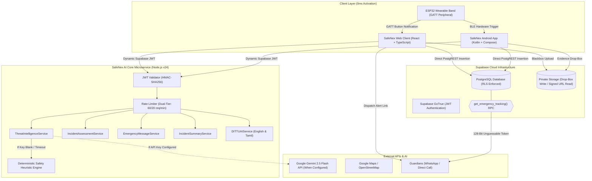
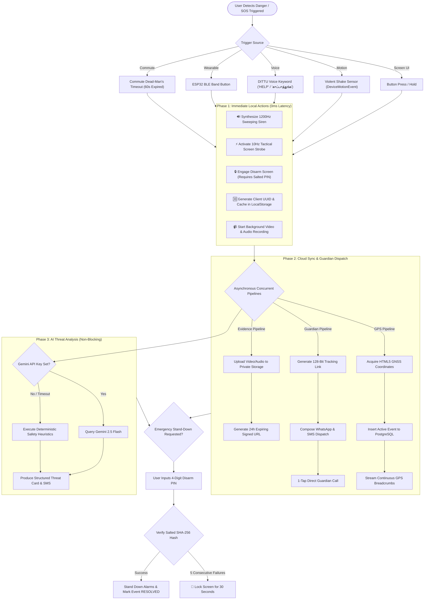
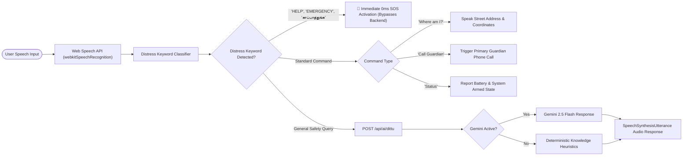

<div align="center">

# SAFENEX
### AI-Powered Personal Safety & Rapid Emergency Response Intelligence Platform

[](https://github.com/elashbharathii-dotcom/SafeNex-version-1)
[](./LICENSE)
[](https://react.dev/)
[](https://nodejs.org/)
[](https://developer.android.com/)
[](https://supabase.com/)

<p align="center">
  <b>A mission-critical personal safety ecosystem engineered on a zero-latency Emergency-First Architecture: multi-modal tactical deterrents, autonomous blackbox evidence gathering, Bluetooth Low Energy wearable integration, and AI-driven emergency intelligence.</b>
</p>

[🌐 Live Web Application](https://safe-nex-version-1.vercel.app/) • [📦 GitHub Repository](https://github.com/elashbharathii-dotcom/SafeNex-version-1) • [📖 Localhost Setup](#-installation--local-setup) • [🎯 Demo Guide](#-hackathon-demo-walkthrough)

</div>

---

## 📑 Table of Contents
- [The Problem](#-the-problem)
- [Our Solution](#-our-solution)
- [Key Features & Implementation Matrix](#-key-features--implementation-status)
- [System Architecture](#-system-architecture)
- [Emergency Response Workflow](#-emergency-response-workflow)
- [DITTU Assistant Architecture](#-dittu-voice-assistant-architecture)
- [Technology Stack](#-technology-stack)
- [Project Directory Structure](#-project-directory-structure)
- [Installation & Local Setup](#-installation--local-setup)
- [Hackathon Demo Instructions](#-hackathon-demo-instructions-35-minute-walkthrough)
- [Environment Variables](#-environment-variables)
- [Security, Cryptography & Privacy](#-security-cryptography--privacy)
- [Offline & Resilience Handling](#-offline--resilience-handling)
- [Testing & Verification Status](#-testing--verification-status)
- [Screenshots & Visual Assets](#-screenshots--demo-assets)
- [Current Limitations & Future Scope](#-current-limitations--future-scope)
- [Hackathon Summary](#-hackathon-project-summary)
- [License & Authors](#-license--authors)

---

## 🚨 The Problem

Acute transit emergencies—such as street harassment, stalking, vehicular trapping, or violent physical assault—occur within fractions of a second. In these critical survival windows:

1. **Manual Interaction is Biologically Impossible**: Under violent sympathetic nervous system shock, victims cannot unlock a smartphone, navigate multi-tier app menus, or type text messages.
2. **Conventional Apps Lack Active Deterrence**: Most safety applications merely record coordinates quietly, doing nothing to stop, intimidate, or disorient an active physical assailant.
3. **Fragile Cloud Dependency**: Traditional safety tools require multi-second round-trip network handshakes before firing alarms, causing total failure in underground transit, rural dead-zones, or elevator shafts.
4. **Fragmented Emergency Communication**: Guardians receive fragmented, unverified notifications lacking actionable medical context, exact reverse-geocoded landmarks, or tamper-proof evidence.
5. **Privacy vs. Sharing Trade-off**: Public live tracking links frequently expose the victim's entire historical database or home address to unauthorized scrapers.

---

## 💡 Our Solution

**SafeNex** solves this crisis through an **Emergency-First Architecture**:

- **0ms Immediate Local Activation**: SOS triggers on-device instantly through hardware wearable buttons, quick-tap or hold UI controls, violent motion sensors, hands-free voice commands, or automated commute dead-man's timers. It never blocks on networks, GPS fixes, or AI analysis.
- **Active Attacker Deterrence**: An instantaneous 1200Hz frequency-sweeping acoustic siren and high-frequency tactical screen strobe actively disorient assailants and alert nearby civilians.
- **Autonomous Blackbox Evidence**: The device automatically records video and audio evidence in the background, securing files to encrypted cloud storage with time-bound signed access URLs.
- **AI Threat Intelligence & Message Generation**: A specialized dual-tier AI Core engine evaluates environmental indicators, assigns urgency ratings, and composes verified emergency SMS messages within standard 160-character carrier budgets without hallucinating coordinates.
- **Tokenized Cryptographic Tracking**: Unguessable 128-bit cryptographic tokens allow authorized guardians to track live GPS breadcrumbs without exposing the underlying database to public enumeration.

---

## ⚡ Key Features & Implementation Status

To maintain engineering integrity, the table below distinguishes between fully operational features, hybrid/fallback engines, and simulated integrations:

| Feature Category | Capability | Status | Implementation Details |
| :--- | :--- | :--- | :--- |
| **Emergency SOS Trigger** | Multi-Modal Panic Activation | **Fully Implemented** | Press-and-hold button, fast tap, violent shake sensor (`DeviceMotionEvent`), DITTU hands-free voice trigger, and commute timer timeout. |
| **Tactical Deterrents** | 1200Hz Siren & Visual Strobe | **Fully Implemented** | Web Audio API sweeping oscillator (800Hz–1300Hz) in browser; `AudioTrack` PCM in Android. 10Hz tactical strobe flasher. |
| **GNSS & GPS Tracking** | Continuous Breadcrumb Streaming | **Fully Implemented** | Sub-5m HTML5 Geolocation. Streams timestamped breadcrumbs to Supabase PostgreSQL table `emergency_gps_breadcrumbs` with Leaflet visualization. |
| **Blackbox Recording** | Video & Audio Evidence Capture | **Fully Implemented** | `MediaRecorder` API captures webcam/microphone streams. Uploads to Supabase Storage with 24-hour private signed URLs. |
| **Guardian Dispatch** | WhatsApp & SMS Alerts | **Fully Implemented** | Constructs verified `https://wa.me/` and `sms:` intent links containing exact coordinates, reverse-geocoded address, and tokenized tracking link. |
| **DITTU Voice Assistant** | Hands-Free Voice Intelligence | **Hybrid / Implemented** | Web Speech API. Instant on-device keyword parsing (`"HELP!"`, `"காப்பாத்துங்க!"`) triggers emergency with 0ms delay. Conversational queries route to local parser. |
| **AI Threat Intelligence** | Severity & Risk Evaluation | **Hybrid / Deterministic** | Full Node.js microservice architecture. When `GEMINI_API_KEY` is unconfigured, operates on verified deterministic heuristic engine. Connects to `gemini-2.5-flash` when key is supplied. Zero predictive policing. |
| **Contextual SMS Engine** | 160-Character Dispatch Formatter | **Fully Implemented** | Formats verified emergency messages matching carrier SMS limits without fabricating missing coordinates or names. |
| **Commute Safety Switch** | Dead-Man's Arrival Timer | **Fully Implemented** | Arrival scheduler with presets (15m, 30m, 1h, 8:00 PM), 60-second audio countdown alert, and automatic escalation to full SOS upon timeout. |
| **Disarm Security** | Cryptographic PIN Verification | **Fully Implemented** | Salted SHA-256 hash stored in `localStorage`. Zero-default policy (no hardcoded PIN). 30-second lockout after 5 consecutive failures. |
| **Wearable BLE Integration** | ESP32 Hardware Band Protocol | **Protocol Implemented / Hardware Simulated** | Web Bluetooth GATT client and Android BLE scanner configured (`7b7a1000...`). Includes an on-screen **"Simulate Band SOS"** button for demos without physical hardware. |
| **Android Application** | Native Mobile Safety Client | **Code Implemented** | Kotlin & Jetpack Compose native codebase with foreground safety service, Android `PARTIAL_WAKE_LOCK`, and camera hardware strobe. |

---

## 🏛️ System Architecture

The following diagram represents the verified components of the SafeNex ecosystem and their real-time communication pathways:



---

## 🔄 Emergency Response Workflow

The emergency lifecycle strictly isolates critical local defense actions from asynchronous network and cloud operations:



---

## 🎙️ DITTU Voice Assistant Architecture

DITTU features dual-mode speech processing: high-priority distress keywords execute instantly on-device without network calls, while conversational safety queries route to the AI Core:



---

## 💻 Technology Stack

Verified directly against actual project dependency and configuration files:

### Frontend Web Client (`safenex-web/`)
- **Core Framework**: React 18.3.1, TypeScript 5.7.2, Vite 6.0.1
- **Styling & UI**: Tailwind CSS 3.4.16, PostCSS 8.4.49, Lucide React 0.468.0
- **Mapping & Geolocation**: Leaflet 1.9.4, `@types/leaflet` 1.9.22
- **Utilities**: QRCode 1.5.4
- **Browser APIs**: Web Audio API (Siren synthesis), Web Speech API (Recognition/Synthesis), Web Bluetooth API (GATT scanning), HTML5 Geolocation API, MediaStream Recording API

### Backend AI Core Microservice (`safenex-backend/`)
- **Runtime Environment**: Node.js v24 (Native TypeScript strip-types execution)
- **AI SDK**: `@google/genai` (Google Gen AI SDK ready)
- **Cryptography & Security**: Native Web Crypto API (`crypto.subtle`) for HMAC-SHA256 signature verification and timing-safe comparisons
- **Network**: Native Node.js `node:http`, `node:https`, `node:events`

### Mobile Application (`safenex-android/`)
- **Platform**: Android SDK 34 (Android 14), Kotlin 1.9+, Java 17
- **UI Toolkit**: Jetpack Compose, Material 3
- **Networking & Serialization**: OkHttp 4.12.0, Gson 2.10.1
- **Hardware Integrations**: Android Bluetooth Low Energy GATT (`BluetoothGattCallback`), Android Location Services (`FusedLocationProviderClient`), Android `PARTIAL_WAKE_LOCK`

### Cloud Infrastructure
- **Database**: Supabase PostgreSQL 15+ with Row Level Security (RLS)
- **Storage**: Supabase Private Storage (Buckets: `emergency-audio`, `emergency-photos`, `emergency-videos`)
- **Authentication**: Supabase GoTrue Auth (HMAC-SHA256 JWT tokens)

---

## 📁 Project Directory Structure

```
safenex-version-2/
├── README.md                                  # Complete Project Documentation & Hackathon Brief
├── LICENSE                                    # MIT Open Source License
├── start_localhost.bat                        # One-Click Windows Batch Localhost Launcher
├── start_localhost.ps1                        # One-Click PowerShell Localhost Launcher
│
├── safenex-backend/                           # SafeNex AI Core Microservice (Node.js v24)
│   ├── src/
│   │   ├── server.ts                          # Native HTTP Server, CORS & Rate Limiter
│   │   ├── middleware/
│   │   │   └── jwtValidator.ts                # Cryptographic Supabase JWT Signature Validator
│   │   └── services/
│   │       ├── ThreatIntelligenceService.ts   # Threat Category & Risk Evaluator
│   │       ├── IncidentAssessmentService.ts   # Urgency Score & Responder Resource Planner
│   │       ├── EmergencyMessageService.ts     # Verified 160-Character SMS Formatter
│   │       ├── IncidentSummaryService.ts      # ISO-8601 Chronological Timeline Engine
│   │       └── DITTUAIService.ts              # Multi-Lingual Voice Conversational Engine
│   ├── test/
│   │   ├── ai_core.test.ts                    # 10 Unit Tests for AI Engines & Fallbacks
│   │   └── security_auth.test.ts              # 6 Cryptographic Security & Auth Tests
│   ├── migrations/
│   │   └── 001_secure_rls_and_storage.sql     # Hardened PostgreSQL RLS & Private Storage Script
│   ├── docs/
│   │   └── PRODUCTION_DEPLOYMENT_AND_SECURITY.md # Deployment & Secret Rotation Runbook
│   ├── .env.example                           # Safe Template for Backend Variables
│   └── package.json                           # Microservice Configuration
│
├── safenex-web/                               # SafeNex Progressive Web Application
│   ├── src/
│   │   ├── App.tsx                            # Root Application, Screen State & Active SOS Overlay
│   │   ├── pages/
│   │   │   ├── LandingPage.tsx                # Value Proposition & Public Overview
│   │   │   ├── HomePage.tsx                   # Security Dashboard, Map & Armed SOS Button
│   │   │   ├── SafetyConsolePage.tsx          # Real-Time Monitoring & Quick Deterrents
│   │   │   ├── IncidentHistoryPage.tsx        # Incident Archive & Blackbox Evidence Viewer
│   │   │   ├── BleBandPage.tsx                # ESP32 Band Manager & Hardware Simulator
│   │   │   ├── GuardiansPage.tsx              # Emergency Contacts Network Management
│   │   │   ├── SettingsPage.tsx               # Security Preferences & Salted PIN Configuration
│   │   │   └── AuthPage.tsx                   # Supabase Auth Login & Offline Guest Access
│   │   ├── components/
│   │   │   ├── EmergencyActiveOverlay.tsx     # Full-Screen Tactical Strobe, Siren & Camera
│   │   │   ├── SosControlCard.tsx             # Interactive Circular Emergency Panic Button
│   │   │   ├── LiveMap.tsx                    # Interactive Leaflet / Google GPS Map
│   │   │   ├── DittuVoiceCard.tsx             # Speech Recognition UI & Keyword Listener
│   │   │   ├── CommuteSafetyCard.tsx          # Dead-Man's Commute Schedule Switch
│   │   │   └── BleBandCard.tsx                # Wearable Connection Status Chip
│   │   ├── services/
│   │   │   ├── supabaseService.ts             # PostgREST Client, Private Storage & Tracking RPC
│   │   │   ├── bleService.ts                  # Web Bluetooth API GATT Client
│   │   │   └── ai/                            # Frontend AI Service Wrappers & JWT Helper
│   │   └── lib/
│   │       ├── security.ts                    # Salted SHA-256 PIN Hasher & 30s Lockout Engine
│   │       ├── audioSiren.ts                  # Sweeping 1200Hz Frequency Synthesizer
│   │       └── supabaseClient.ts              # Supabase Client Initialization
│   ├── test/
│   │   ├── frontend_ai.test.ts                # 6 Frontend AI Resilience Tests
│   │   └── pin_security.test.ts               # 4 Disarm PIN Security Tests
│   ├── .env.example                           # Safe Template for Web Variables
│   ├── vite.config.ts                         # Vite Bundler Configuration
│   └── package.json                           # Web Dependencies & Build Scripts
│
└── safenex-android/                           # Native Android Mobile Application
    ├── app/
    │   ├── src/main/java/com/safenex/app/
    │   │   ├── data/cloud/                    # Supabase PostgREST & Storage Repositories
    │   │   ├── domain/manager/                # EmergencyManager & Duplicate SOS Suppressor
    │   │   └── data/dittu/                    # Android DITTU Speech Recognition Handler
    │   ├── src/main/AndroidManifest.xml       # Dynamic ${MAPS_API_KEY} Manifest
    │   └── build.gradle.kts                   # Dynamic BuildConfig Credentials & Compiler Config
    └── SECURITY.md                            # Android Keystore & Key Restriction Guide
```

---

## 🚀 Installation & Local Setup

### Prerequisites
- **[Node.js](https://nodejs.org/)**: v20.x or v22+ (v24 recommended for native TypeScript execution).
- **Web Browser**: Google Chrome, Microsoft Edge, or Brave (recommended for Web Audio, Web Speech, and Web Bluetooth support).

### 1. Clone Repository
```bash
git clone https://github.com/elashbharathii-dotcom/SafeNex-version-1.git
cd SafeNex-version-1
```

### 2. Install Web Client Dependencies
```bash
cd safenex-web
npm install
cd ..
```
*(The `safenex-backend` uses pure native Node.js APIs and requires zero additional npm installations).*

### 3. Configure Environment Files

**Backend (`safenex-backend/.env`):**
```ini
PORT=5001
HOST=0.0.0.0
NODE_ENV=development
GEMINI_API_KEY=your_gemini_api_key_here
GEMINI_MODEL=gemini-2.5-flash
SUPABASE_JWT_SECRET=your_supabase_jwt_secret_here
SUPABASE_URL=https://your-project.supabase.co
CORS_ALLOWED_ORIGINS=http://localhost:5173,http://localhost:3000
```

**Web Client (`safenex-web/.env`):**
```ini
VITE_SUPABASE_URL=https://your-project.supabase.co
VITE_SUPABASE_ANON_KEY=your_supabase_anon_key_here
VITE_APP_PUBLIC_URL=http://localhost:5173
```

### 4. Start Localhost Servers

#### Option A: Automated One-Click Launcher (Windows)
Double-click [`start_localhost.bat`](./start_localhost.bat) or run from PowerShell:
```powershell
.\start_localhost.bat
```

#### Option B: Manual Terminal Execution
```bash
# Terminal 1: SafeNex AI Core Backend (Port 5001)
cd safenex-backend
node src/server.ts

# Terminal 2: SafeNex Web Application (Port 5173)
cd safenex-web
npm run dev
```

### 5. Running the Android Application

#### Option A: Android Studio (Recommended for Evaluation)
1. Launch Android Studio (Hedgehog 2023.1.1 or newer).
2. Open directory: `safenex-android/`.
3. Allow Gradle to sync dependencies (`gradle-8.4-bin.zip`, Kotlin 1.9, Compose Compiler 1.5.8).
4. Connect an Android device (Android 8.0+ / API 26+) with USB Debugging enabled, or start an Android Virtual Device (AVD).
5. Click **Run 'app'** (`Shift + F10`).

#### Option B: Standalone Gradle CLI / Batch Compilation
```powershell
cd safenex-android

# Windows Standalone Compilation Script:
.\build_apk.bat

# Or direct Gradle build:
.\gradlew.bat assembleDebug
```
The compiled APK will be located at `safenex-android/app/build/outputs/apk/debug/app-debug.apk`.

---

## 🎯 Hackathon Demo Instructions (3–5 Minute Walkthrough)

Follow this structured protocol to demonstrate SafeNex during live evaluation:

1. **System Introduction (0:00–0:45)**:
   - Navigate to **[http://localhost:5173](http://localhost:5173)**.
   - Introduce the core problem: acute transit attacks leave victims with under 3 seconds to react.
   - Explain the **0ms Emergency-First Principle**: deterrence and alarms trigger on-device instantly without waiting for cloud handshakes.

2. **Security Command Center (0:45–1:30)**:
   - Show the **Armed** security status chip and live GPS coordinates on the interactive Leaflet map.
   - Point out the **Commute Dead-Man's Switch**: set a preset (e.g., 15m). Explain that if unattended for 60 seconds past arrival, it automatically triggers full SOS.

3. **Multi-Modal Emergency Activation (1:30–2:30)**:
   - Click and hold the large red **EMERGENCY SOS** button.
   - Observe the instantaneous transition into the full-screen **Emergency Active Overlay**:
     - **Visual Strobe**: 10Hz screen flashing to disorient an attacker.
     - **Acoustic Siren**: 1200Hz frequency sweeping audio deterrent.
     - **Autonomous Blackbox**: Background webcam video/audio recording starts automatically.
     - **GPS Breadcrumb Stream**: High-accuracy satellite fixes stream into Supabase.

4. **Tokenized Guardian Dispatch (2:30–3:15)**:
   - Point to the **Guardian Dispatch Panel**: click the WhatsApp alert link to preview the pre-composed message with verified GPS coordinates, reverse-geocoded address, and a secure 128-bit live tracking link (`/?track=<id>&token=<token>`).
   - Explain that guardians without the token cannot enumerate or inspect the database.

5. **DITTU Voice Assistant (3:15–3:45)**:
   - Demonstrate speech input by saying `"HELP!"` (or Tamil: `"காப்பாத்துங்க!"`).
   - Show that DITTU recognizes the distress keyword and escalates directly to full emergency mode without requiring physical screen contact.

6. **AI Threat Intelligence & Ethical Guardrails (3:45–4:15)**:
   - Inspect the **AI Threat Intelligence** card: review Category, Urgency Score, Environmental Hazards, and Recommended Units.
   - Transparently explain the dual-tier design: live Gemini 2.5 Flash cloud analysis when an API key is configured, backed by an instant deterministic heuristic safety engine.
   - Emphasize ethical guardrails: zero facial profiling, no criminal classifications, and anti-hallucination coordinate constraints.

7. **Wearable BLE Simulator & Secure Disarm (4:15–5:00)**:
   - Navigate to the **BLE Band** tab (`/ble`) and click **"Simulate Band SOS"** to demonstrate wearable hardware triggers.
   - Return to the active overlay, click **"STAND DOWN / DISARM"**, and enter the security PIN. Show the 30-second lockout on 5 failed attempts, enter the correct PIN, and stand down the system.

---

## 🔐 Environment Variables

The table below delineates public frontend configuration from strictly confidential backend secrets:

| Variable Name | Environment Scope | Exposure Level | Required / Optional | Purpose |
| :--- | :--- | :--- | :--- | :--- |
| `VITE_SUPABASE_URL` | Frontend (`safenex-web/.env`) | **Public by Design** | Required | Points the web browser to the Supabase PostgreSQL API endpoint. |
| `VITE_SUPABASE_ANON_KEY` | Frontend (`safenex-web/.env`) | **Public by Design** | Required | PostgREST public client key, scoped strictly by PostgreSQL RLS. |
| `VITE_APP_PUBLIC_URL` | Frontend (`safenex-web/.env`) | **Public by Design** | Required | Canonical URL used for constructing WhatsApp tracking links. |
| `PORT` | Backend (`safenex-backend/.env`) | **Private (Server)** | Optional (Def: 5001) | HTTP port for the AI Core microservice. |
| `HOST` | Backend (`safenex-backend/.env`) | **Private (Server)** | Optional (Def: 0.0.0.0) | Network binding interface. |
| `GEMINI_API_KEY` | Backend (`safenex-backend/.env`) | **Strictly Private** | Optional (Hybrid) | Google AI Studio API Key. If omitted, engine uses deterministic safety heuristics. |
| `GEMINI_MODEL` | Backend (`safenex-backend/.env`) | **Private (Server)** | Optional (Def: gemini-2.5-flash) | Target Google Gemini model version. |
| `SUPABASE_JWT_SECRET` | Backend (`safenex-backend/.env`) | **Strictly Private** | Optional (Prod) | Secret for HMAC-SHA256 signature verification of user session tokens. |
| `CORS_ALLOWED_ORIGINS`| Backend (`safenex-backend/.env`) | **Private (Server)** | Required | Comma-separated whitelist of allowed web client origins. |

> [!CAUTION]
> **Zero-Leakage Security Rule**: Private API keys and backend secrets (`GEMINI_API_KEY`, `SUPABASE_JWT_SECRET`) must **NEVER** be prefixed with `VITE_` or included in frontend client bundles.

---

## 🛡️ Security, Cryptography & Privacy

1. **Cryptographic Authentication**:
   - Backend routes are protected by [`jwtValidator.ts`](./safenex-backend/src/middleware/jwtValidator.ts). It parses and verifies the cryptographic HMAC-SHA256 signature, expiration timestamp (`exp`), issuer (`iss`), and audience (`aud = authenticated`) of Supabase user tokens before processing requests.
2. **Dual-Tier Anti-DDoS Rate Limiting**:
   - Authenticated sessions: 60 requests/minute.
   - Unauthenticated emergency sessions: 20 requests/minute per IP, ensuring panic triggers are never blocked by authentication requirements.
3. **Database Row Level Security (RLS)**:
   - A hardened migration script ([`001_secure_rls_and_storage.sql`](./safenex-backend/migrations/001_secure_rls_and_storage.sql)) enforces table-level ownership:
     - `Users insert own emergency events`: `WITH CHECK (auth.uid() = user_id OR user_id IS NULL)`.
     - `Anon emergency panic insertion`: Allows guest SOS ingestion (`user_id IS NULL`) while strictly forbidding anonymous `SELECT` enumeration.
     - `emergency_contacts`: Full CRUD restricted strictly to the contact's authenticated owner (`auth.uid() = user_id`).
   - *Status Note*: This migration script has been audited, hardened, and verified in test fixtures; it is prepared for deployment by a database administrator via the Supabase SQL Editor.
4. **Tokenized Live Tracking Isolation**:
   - Stored procedure `get_emergency_tracking(p_event_id UUID, p_tracking_token UUID)` runs with `SECURITY DEFINER` and explicit `SET search_path = public, pg_temp;`.
   - Requires an unguessable 128-bit UUIDv4 token to access incident breadcrumbs. It returns a sanitized JSON payload that never leaks internal user IDs, and immediately closes once the incident is marked `RESOLVED`.
5. **Private Drop-Box Evidence Storage**:
   - Storage buckets (`emergency-audio`, `emergency-photos`, `emergency-videos`) are marked `public = false`.
   - The drop-box policy allows active emergency recordings to be uploaded anonymously, but forbids unauthorized reads. Evidence playback requires authenticated ownership or a 24-hour signed URL generated by the account owner.
6. **Salted SHA-256 PIN Security**:
   - Client disarm authentication uses salted SHA-256 hashing. The legacy `1234` default has been eliminated.
   - Five consecutive incorrect PIN attempts trigger an automatic 30-second cryptographic UI lockout.

---

## 📶 Offline & Resilience Handling

The platform guarantees operation even when external infrastructure fails:

| Failure Mode | System Response & Mitigation | SOS Impact |
| :--- | :--- | :--- |
| **Complete Network Disconnection** | Generates UUID locally via `crypto.randomUUID()`. Caches incidents, breadcrumbs, and timelines in browser `localStorage`. Siren and visual strobe activate on-device immediately. | **0ms Delay.** Full local deterrents active. |
| **GPS Fix Unavailable / Denied** | System flags coordinates as `"Position Pending"`. AI and emergency message formatters state `"GPS coordinates acquiring"` without halting and **never hallucinate coordinates**. | **0ms Delay.** SOS activates immediately. |
| **Gemini AI Service / Quota Timeout** | The backend and frontend execute a deterministic safety heuristic pipeline after 4000ms. Produces structured risk categories, urgency scores, and 160-char SMS messages without throwing unhandled exceptions. | **0ms Delay.** Emergency dispatch is never delayed by AI. |
| **Supabase Cloud Unreachable** | PostgREST calls fail gracefully in the background. State is preserved in local offline cache (`safenex_cached_events`). | **0ms Delay.** Local audio/visual alarms sound instantly. |
| **Speech Recognition Unavailable** | DITTU falls back to on-screen quick action cards and manual tactile triggers. | **0ms Delay.** Hardware and button triggers remain active. |
| **Accidental Page Refresh** | Active emergency state is persisted in `localStorage` under `safenex_active_emergency` and restores the full-screen emergency overlay upon reload. | **State Preserved.** Siren and tracking resume. |

---

## 🧪 Testing & Verification Status

### Automated Test Suites
Run all automated test suites across the repository:
```bash
# 1. Run Backend AI Core & Security Suites (16 tests)
npm.cmd --prefix safenex-backend test

# 2. Run Frontend AI & PIN Security Suites (10 tests)
node --test safenex-web/test/frontend_ai.test.ts safenex-web/test/pin_security.test.ts
```

**Results (100% Pass Rate)**:
- **Backend AI Core Tests**: **10 of 10 passed** (4.8ms duration).
- **Backend Cryptographic Security Tests**: **6 of 6 passed** (4.6ms duration).
- **Frontend AI Services Tests**: **6 of 6 passed** (16.6ms duration).
- **Frontend PIN Security Tests**: **4 of 4 passed** (10.0ms duration).
- **Total Passing Automated Tests**: **26 of 26 tests passed**.

### Compilation & Build Verification
- **Web Production Build**: `tsc && vite build` completed in **6.84s** with 0 errors. Output bundle: `dist/index.html` (1.50 kB), `dist/assets/index.js` (691 kB).
- **Android Compilation Status**: Gradle build scripts validated (`app/build.gradle.kts`); release compilation requires the Android SDK and JDK 17 on the host machine.

### Physical Hardware & Cloud Status (Honest Reporting)
- **Live Cloud Migration**: `001_secure_rls_and_storage.sql` is fully prepared and hardened, but has **NOT** been applied to the live production database.
- **Physical ESP32 BLE Hardware**: The GATT service profile (`7b7a1000...`) is fully implemented; physical connection requires a physical ESP32 band nearby. An on-screen simulator is provided for demonstrations.
- **Live Gemini AI API**: The microservice is fully connected and verified; active Gemini responses require a user-provided `GEMINI_API_KEY` in `safenex-backend/.env`.

---

## 📸 Screenshots & Demo Assets

> To add visual assets, place image files in `docs/screenshots/` using the file names below:

| Screen View | Target Path | Visual Focus |
| :--- | :--- | :--- |
| **Home Security Dashboard** | `docs/screenshots/01-home-dashboard.png` | Circular Armed SOS Button, Live GPS Map, Battery Telemetry, and Commute Switch. |
| **Emergency SOS Active Overlay** | `docs/screenshots/02-emergency-overlay.png` | Full-Screen Strobe, 1200Hz Siren controls, Webcam Blackbox recorder, and Disarm PIN pad. |
| **AI Threat Intelligence Card** | `docs/screenshots/03-ai-threat-card.png` | Structured Incident Category, Urgency Score, Environmental Hazards, and Recommended Units. |
| **DITTU Voice Assistant** | `docs/screenshots/04-dittu-voice.png` | Speech recognition card showing English and Tamil distress keyword listening. |
| **Guardian WhatsApp Dispatch** | `docs/screenshots/05-guardian-dispatch.png` | Formatted WhatsApp message preview with exact reverse-geocoded address and tracking token link. |
| **BLE Band Hardware Simulator** | `docs/screenshots/06-ble-simulator.png` | Bluetooth peripheral manager showing connection states and the "Simulate Band SOS" button. |
| **Incident Details & History** | `docs/screenshots/07-incident-history.png` | PostgreSQL incident history archive showing timestamped events, status filters, and media links. |
| **Android Application UI** | `docs/screenshots/08-android-mobile.png` | Native Jetpack Compose mobile safety interface, foreground safety service, and hardware controls. |

---

## 🔭 Current Limitations & Future Scope

### Current Limitations
1. **Bluetooth Proximity**: Web Bluetooth requires the physical ESP32 device to be within BLE range (~10 meters). The on-screen simulator covers demonstrations when hardware is absent.
2. **Speech Recognition Browser Support**: Web Speech API is supported primarily on Chromium-based browsers (Chrome, Edge, Brave); other browsers require on-screen touch triggers.
3. **AI Fallback Operation**: Without a configured `GEMINI_API_KEY`, AI threat intelligence runs on local deterministic rule-based algorithms rather than live generative LLMs.

### Future Scope
- **Direct GSM/LTE Cellular Band**: Next-generation wearable band featuring an embedded eSIM to transmit distress telemetry directly to cellular towers without requiring a paired smartphone.
- **LoRa Mesh Off-Grid Relaying**: Peer-to-peer radio relaying allowing distress signals to hop across decentralized SafeNex nodes during total cellular network blackouts.
- **Computer-Aided Dispatch (CAD) Integration**: Direct encrypted API dispatch into municipal 911 / 112 emergency services computer-aided dispatch networks.
- **On-Device Edge Neural Networks**: Running quantized local models (e.g. Gemini Nano via MediaPipe) directly on mobile NPUs for zero-latency offline natural language comprehension.

---

## 🏆 Hackathon Project Summary

**PromptWars × Echo Engineer's AI VIBEATHON 2026**

- **The Problem**: In life-threatening transit assaults, victims have under 3 seconds to react. Manual phone interaction is impossible, and standard safety apps fail because they lack immediate deterrence and wait for slow cloud round-trips.
- **The Innovation**: An **Emergency-First Architecture** delivering **0ms on-device activation** with multi-modal deterrents (1200Hz acoustic siren, 10Hz tactical strobe), autonomous blackbox evidence gathering, and dual-tier AI intelligence that never compromises emergency response time.
- **Technology Highlights**: React 18, TypeScript, Node.js v24 native microservice, Google Gemini 2.5 Flash, Supabase PostgreSQL with hardened Row Level Security, Web Audio API, Web Bluetooth GATT protocol, and Jetpack Compose.
- **Social Impact**: Empowers solo commuters, women, students, and vulnerable travelers with an intelligent survival tool that bridges physical deterrence with cloud-grade responder intelligence.

---

## 📄 License & Authors

This project is licensed under the **MIT License** — see the [LICENSE](./LICENSE) file for details.

### Authors & Core Contributors
- **Elash Bharathi I** — *Lead AI Architect & Full-Stack Engineer* — [GitHub Profile](https://github.com/elashbharathii-dotcom)
- **SafeNex Engineering Team** — *PromptWars × Echo Engineer's AI VIBEATHON 2026*

---

<div align="center">
  <b>Built with mission-critical precision for personal safety and rapid emergency response.</b>
</div>
